<a href="https://lauralys.com"><picture><source media="(max-width: 600px) and (prefers-color-scheme: dark)" srcset="assets/hero-m-dark.svg"><source media="(max-width: 600px)" srcset="assets/hero-m-light.svg"><source media="(prefers-color-scheme: dark)" srcset="assets/hero-dark.svg"></picture></a>

<a href="https://lauralys.com"><picture><source media="(max-width: 600px) and (prefers-color-scheme: dark)" srcset="assets/portfolio-m-dark.svg"><source media="(max-width: 600px)" srcset="assets/portfolio-m-light.svg"><source media="(prefers-color-scheme: dark)" srcset="assets/portfolio-dark.svg"></picture></a><a href="https://lauralys.com/blog-laura-lys/"><picture><source media="(max-width: 600px) and (prefers-color-scheme: dark)" srcset="assets/writing-m-dark.svg"><source media="(max-width: 600px)" srcset="assets/writing-m-light.svg"><source media="(prefers-color-scheme: dark)" srcset="assets/writing-dark.svg"></picture></a><a href="https://lauralys.com/contacto/"><picture><source media="(max-width: 600px) and (prefers-color-scheme: dark)" srcset="assets/hello-m-dark.svg"><source media="(max-width: 600px)" srcset="assets/hello-m-light.svg"><source media="(prefers-color-scheme: dark)" srcset="assets/hello-dark.svg"></picture></a>

<picture><source media="(max-width: 600px) and (prefers-color-scheme: dark)" srcset="assets/cards-m-dark.svg"><source media="(max-width: 600px)" srcset="assets/cards-m-light.svg"><source media="(prefers-color-scheme: dark)" srcset="assets/cards-dark.svg"></picture>

